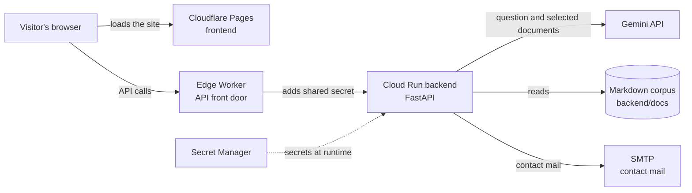

# AI Portfolio Kit

**A portfolio site with an AI chat that answers only from your own markdown files.**

A React + TypeScript frontend on Cloudflare Pages, a Cloudflare Worker as the API front door,
and a FastAPI backend on Google Cloud Run that calls the Gemini API and sends contact mail over
SMTP. The repository is MIT licensed and meant to be forked.

## Why it exists

- **A portfolio chat speaks for a real person.** It answers in the owner's first person, so an
  invented employer or date is a false claim about someone, not just a wrong answer. The chat is
  given the owner's markdown files and nothing else to answer from.
- **No corpus means no answer.** If the profile documents are missing, the backend refuses to
  call the model instead of answering from placeholders.
- **A public API costs money per call.** The chat endpoint is unauthenticated and spends model
  quota, so it sits behind an edge Worker with a shared secret and behind per-client and global
  rate limits.
- **Small enough to read.** One backend process, a folder of markdown, no database.

## Quick start

```bash
git clone https://github.com/Yanir-R/ai-portfolio-kit.git
cd ai-portfolio-kit
```

Prerequisites:

- Node.js >= 22.22.0 and npm >= 10.8.2 (see `engines` in [frontend/package.json](frontend/package.json))
- Python 3.12
- A Gemini API key from [Google AI Studio](https://aistudio.google.com/apikey), placed in the
  backend's local env file as described in [backend/README.md](backend/README.md#configuration)

Run the backend first, then the frontend. The edge Worker is not needed locally.

```bash
# Terminal 1: backend on http://localhost:8000
cd backend
python3.12 -m venv venv
source venv/bin/activate          # Windows: .\venv\Scripts\activate
pip install -r requirements.txt
uvicorn main:app --reload --port 8000
```

```bash
# Terminal 2: frontend on http://localhost:3000
cd frontend
npm install
npm run dev
```

## Fork setup

Three committed values tie this repository to yanirrot.com. None of them is a
secret, and a fork must change all three:

| Value | File | This repository | In a fork |
|---|---|---|---|
| Site URL | `frontend/site.config.ts` → `url` | `https://yanirrot.com` | Your site's public origin |
| API URL | `frontend/site.config.ts` → `backendUrl` | `https://api.yanirrot.com` | `https://api.<your-domain>`; must equal the Worker route below |
| Worker route | `edge/wrangler.jsonc` → `routes[0].pattern` | `api.yanirrot.com` | `api.<your-domain>` (the zone must already be on Cloudflare) |
| Origin URL | `edge/wrangler.jsonc` → `vars.ORIGIN_URL` | the Cloud Run backend's `run.app` URL | Your own Cloud Run service URL |

The API URL and the Worker route are one value written in two places; if they
disagree, the browser calls a host the Worker does not serve. The public
Turnstile site key in `frontend/src/constants/turnstile.ts` is also yours to
replace (see the [edge README](edge/README.md#turnstile)).

Deploy order, so no step strands the site:

1. **Backend.** Deploy to Cloud Run with `ORIGIN_SHARED_SECRET` still unset, and
   copy its `run.app` URL into `ORIGIN_URL`.
2. **Worker.** From `edge/`, set `EDGE_SECRET` and `TURNSTILE_SECRET_KEY` with
   `npx wrangler secret put`, then `npx wrangler deploy`.
3. **Frontend.** With `url` and `backendUrl` set, deploy to Cloudflare Pages.
   The site now reaches the API through the Worker.
4. **Enforce.** Give the backend `ORIGIN_SHARED_SECRET` equal to `EDGE_SECRET`
   and redeploy. Direct `run.app` calls now return 403.

Details: [edge README](edge/README.md) and [frontend README](frontend/README.md).

## How it works



<p align="center">
  
</p>

1. The browser loads a static bundle from Cloudflare Pages.
2. API calls go to the API hostname, served by the Worker in `edge/`. The Worker adds a shared
   secret header and forwards the request to the backend.
3. The backend checks the header, applies rate limits, picks the documents the question needs
   from the markdown corpus and calls the Gemini API with them.
4. An email address left in the chat, or a message sent to the contact endpoint, is delivered to
   the owner's inbox over SMTP.

The design is described in [docs/ARCHITECTURE.md](docs/ARCHITECTURE.md).

## Limitations

Stated plainly, so you know what you are forking:

- **Rate-limit counters live in the backend process.** Run one process per instance; every
  extra process or instance multiplies the global ceiling (`backend/rate_limit.py`).
- **The edge Worker is deployed by hand, not by CI.** Neither workflow in `.github/workflows/`
  touches `edge/`; see [edge/README.md](edge/README.md).
- **The edge secret is enforced only when it is set.** With `ORIGIN_SHARED_SECRET` unset the
  backend accepts direct requests (`backend/main.py`).
- **The chat answers only from the committed markdown, so it declines what is not there.** The
  corpus is the files under `backend/docs/` and nothing else (`backend/context.py`). Whether the
  model always follows that instruction cannot be proven offline (unverified).
- **The profile documents are public.** Everything under `backend/docs/` is tracked in this
  repository and sent to the Gemini API; the profile folder is also served by `/api/content/`.
- **The answer trace reports what the model was given, not what it used.** No step attributes an
  answer to a document (`backend/main.py`, `backend/context.py`).
- **Document selection is word overlap with English and Hebrew stopword lists.** A Hebrew
  question is matched against the Hebrew documents in `backend/docs/he/`. When no term
  distinguishes a document, every document is sent (`backend/selection.py`).
- **The SMTP host is fixed in code** to one mail provider (`backend/main.py`).
- **The frontend has no automated tests.** `frontend/package.json` defines typecheck, lint,
  format and build scripts, and no test script.

## What works today

Each item names the file or test that shows it. Tests are in `backend/tests/` and run offline.

| What | Proof |
|---|---|
| The corpus is built from profile, project and writing documents and cached until a file changes | `backend/context.py`; `test_context_layer.py::test_corpus_loads_profile_and_projects`, `::test_corpus_is_cached_between_calls` |
| A corpus with no profile is treated as empty, and template placeholders never reach the model | `test_context_layer.py::test_corpus_without_profile_fails_closed`, `::test_corpus_never_falls_back_to_template_placeholders` |
| With an empty corpus the model is not called | `test_context_layer.py::test_empty_corpus_is_refused_without_calling_the_model` |
| The instruction given to the model states the grounding rules and fences the corpus | `test_context_layer.py::test_system_instruction_states_the_grounding_rules`, `::test_system_instruction_fences_the_corpus` |
| Each question gets only the documents it needs; profile documents are always kept; an unknown subject gets everything | `backend/selection.py`; `test_selection.py` |
| Oversized or empty chat requests are rejected | `backend/main.py`; `test_context_layer.py::test_oversized_message_is_rejected`, `::test_empty_message_is_rejected`, `::test_unbounded_history_is_rejected` |
| Interface banners are not replayed to the model as conversation | `test_context_layer.py::test_ui_chrome_is_not_replayed_as_conversation` |
| Per-client and global rate limits, answering 429 with `Retry-After` | `backend/rate_limit.py` (code; no limiter test was read for this list) |
| The client identity used for rate limiting cannot be claimed by a forged header | `test_client_identity.py` |
| The backend rejects guarded requests without the edge secret when one is configured | `backend/main.py` (`require_edge_secret`) |
| The Worker replaces any client-sent secret header, refuses to run unconfigured, and answers 502 when the backend is unreachable | `edge/src/index.js` (code; no test) |
| An invalid address or oversized message never reaches mail delivery or spends a rate-limit slot | `test_contact_endpoint.py` |
| An address left in the chat is emailed, and a failed send tells the visitor so | `test_email_delivery.py` (mail transport stubbed) |
| When the upstream API refuses, the chat falls back through its model list and then answers "busy" without queueing | `test_quota_resilience.py`; `test_context_layer.py::test_quota_exhaustion_advances_through_every_model` |
| `/api/content/` is confined to the profile folder | `backend/main.py` (`get_content`; code, no test was read) |
| Usage figures are shown only for answers a model produced | `test_context_layer.py::test_a_reply_the_model_never_produced_carries_no_trace` |
| Pull requests run verify jobs; deploys run only on a push to `main` | `.github/workflows/backend-deploy.yml`, `.github/workflows/frontend-deploy.yml` |
| Frontend typecheck, lint, format check and build | scripts in `frontend/package.json`, run by `frontend-deploy.yml` |
| The model follows the grounding rules for every question | (unverified) |
| Real mail delivery through an SMTP server | (unverified) |
| Frontend behaviour in a browser | (unverified) |
| A full deployment working end to end | (unverified) |

## Documentation

- [docs/ARCHITECTURE.md](docs/ARCHITECTURE.md): components, request path, configuration, API, context layer, CI.
- [docs/PRIVACY.md](docs/PRIVACY.md): what a visitor's message touches and what is kept.
- [docs/ROADMAP.md](docs/ROADMAP.md): ideas for next steps, not commitments.
- [docs/REVIEW-LOG.md](docs/REVIEW-LOG.md): the per-file review record.
- [CONTRIBUTING.md](CONTRIBUTING.md), [SECURITY.md](SECURITY.md), [TRADEMARK.md](TRADEMARK.md).
- Component READMEs: [frontend/](frontend/README.md), [backend/](backend/README.md),
  [edge/](edge/README.md), [.github/workflows/](.github/workflows/README.md).

## Contributing

Issues and small pull requests are welcome. Read [CONTRIBUTING.md](CONTRIBUTING.md) first;
commits are signed off under the [DCO](DCO). To report a security problem, see
[SECURITY.md](SECURITY.md).

## License

MIT. See [LICENSE](LICENSE). The project name and the owner's personal content are covered by
[TRADEMARK.md](TRADEMARK.md).
