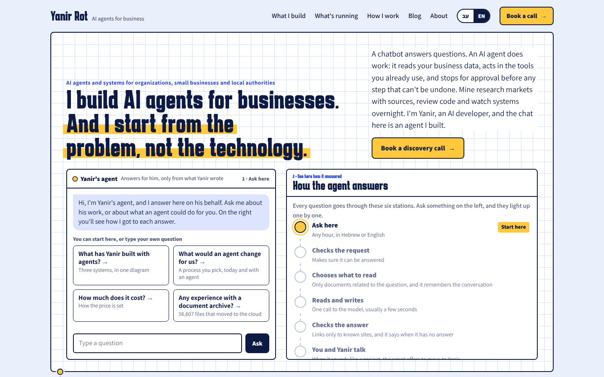
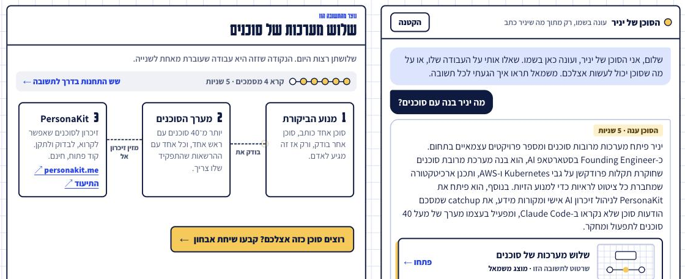
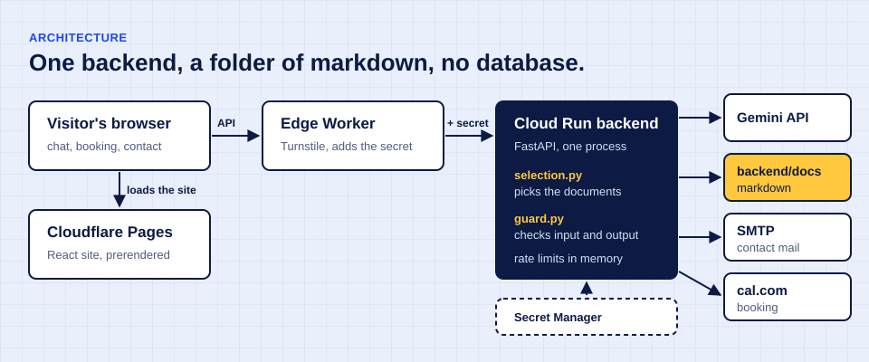
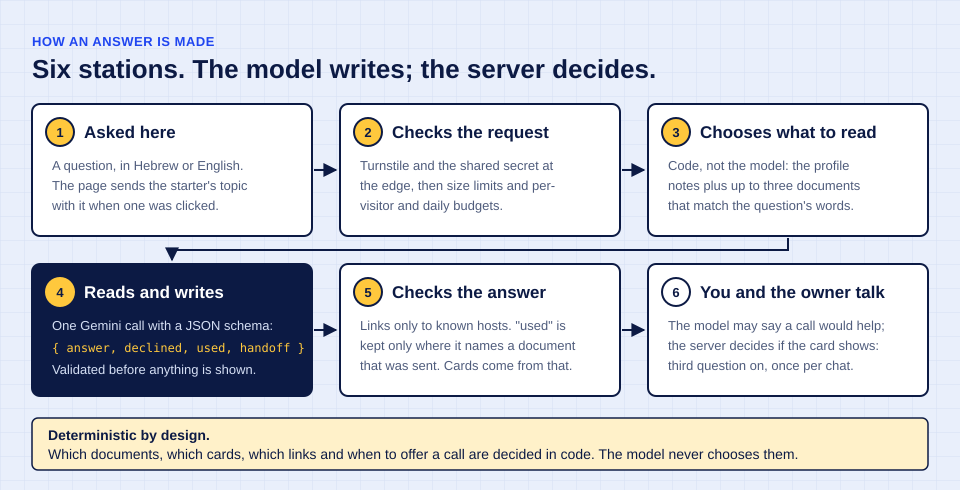

<p align="center">
  
</p>

<h1 align="center">AI Portfolio Kit</h1>

<p align="center">
  <strong>A portfolio site with an AI agent that answers only from your own markdown.</strong><br>
  Hebrew and English, documents chosen in code, structured model output, and a receipt under every answer.
</p>

<p align="center">
  <a href="LICENSE"></a>
  
  
  
  
</p>

<p align="center">
  
</p>

<p align="center">
  Live: <a href="https://yanirrot.com">yanirrot.com</a> (Hebrew) · <a href="https://yanirrot.com/en">yanirrot.com/en</a> (English)
</p>

A React + TypeScript frontend on Cloudflare Pages, a Cloudflare Worker as the API front door,
and a FastAPI backend on Google Cloud Run that calls the Gemini API, sends contact mail over
SMTP and books calls on cal.com. The repository is MIT licensed and meant to be forked.

## Why it exists

- **The chat speaks for a real person.** It answers as the owner's agent, so an invented
  employer or date is a false claim about someone, not just a wrong answer. It is given the
  owner's markdown files and nothing else to answer from, and says so when they do not cover a
  question.
- **The model writes; the code decides.** Which documents a question gets, which cards and
  links appear beside the answer, and when to offer a call with the owner are all decided by the
  server. The model returns typed fields, and each one is checked before it is used.
- **Every answer shows its receipt.** What was read, how long it took, and which documents the
  answer drew on, under every reply, including the ones written without a model.
- **A public API costs money per call.** The chat endpoint is unauthenticated and spends model
  quota, so it sits behind an edge Worker with Turnstile and a shared secret, and behind
  per-visitor and daily limits.
- **Small enough to read.** One backend process, a folder of markdown, no database.

<p align="center">
  
</p>

## Quick start

```bash
git clone https://github.com/Yanir-R/ai-portfolio-kit.git
cd ai-portfolio-kit
```

Prerequisites:

- Node.js >= 22.22.0 and npm >= 10.8.2 (see `engines` in [frontend/package.json](frontend/package.json))
- Python 3.12
- A Gemini API key from [Google AI Studio](https://aistudio.google.com/apikey), placed in the
  backend's local env file as described in [backend/README.md](backend/README.md#configuration)

Run the backend first, then the frontend. The edge Worker is not needed locally.

```bash
# Terminal 1: backend on http://localhost:8000
cd backend
python3.12 -m venv venv
source venv/bin/activate          # Windows: .\venv\Scripts\activate
pip install -r requirements.txt
uvicorn main:app --reload --port 8000
```

```bash
# Terminal 2: frontend on http://localhost:3000
cd frontend
npm install
npm run dev
```

## Fork setup

Four committed values tie this repository to yanirrot.com. None of them is a
secret, and a fork must change all four:

| Value | File | This repository | In a fork |
|---|---|---|---|
| Site URL | `frontend/site.config.ts` → `url` | `https://yanirrot.com` | Your site's public origin |
| API URL | `frontend/site.config.ts` → `backendUrl` | `https://api.yanirrot.com` | `https://api.<your-domain>`; must equal the Worker route below |
| Worker route | `edge/wrangler.jsonc` → `routes[0].pattern` | `api.yanirrot.com` | `api.<your-domain>` (the zone must already be on Cloudflare) |
| Origin URL | `edge/wrangler.jsonc` → `vars.ORIGIN_URL` | the Cloud Run backend's `run.app` URL | Your own Cloud Run service URL |

The API URL and the Worker route are one value written in two places; if they
disagree, the browser calls a host the Worker does not serve. The public
Turnstile site key in `frontend/src/constants/turnstile.ts` is also yours to
replace (see the [edge README](edge/README.md#turnstile)).

Deploy order, so no step strands the site:

1. **Backend.** Deploy to Cloud Run with `ORIGIN_SHARED_SECRET` still unset, and
   copy its `run.app` URL into `ORIGIN_URL`.
2. **Worker.** From `edge/`, set `EDGE_SECRET` and `TURNSTILE_SECRET_KEY` with
   `npx wrangler secret put`, then `npx wrangler deploy`.
3. **Frontend.** With `url` and `backendUrl` set, deploy to Cloudflare Pages.
   The site now reaches the API through the Worker.
4. **Enforce.** Give the backend `ORIGIN_SHARED_SECRET` equal to `EDGE_SECRET`
   and redeploy. Direct `run.app` calls now return 403.

Details: [edge README](edge/README.md) and [frontend README](frontend/README.md).

## How it works

<p align="center">
  
</p>

1. The browser loads a static bundle from Cloudflare Pages.
2. API calls go to the API hostname, served by the Worker in `edge/`. The Worker adds a shared
   secret header and forwards the request to the backend.
3. The backend checks the header, applies rate limits, picks the documents the question needs
   from the markdown corpus (in code, see `backend/selection.py`) and calls the Gemini API
   with them, asking for a JSON reply.
4. An email address left in the chat, or a message sent to the contact endpoint, is delivered to
   the owner's inbox over SMTP.

The design is described in [docs/ARCHITECTURE.md](docs/ARCHITECTURE.md).

### How an answer is made

<p align="center">
  
</p>

The model's reply is one JSON object, validated against `ModelReply` in
`backend/gemini_helper.py`:

| Field | What the server does with it |
|---|---|
| `answer` | Shown after the output checks in `backend/guard.py`: links only to known hosts, no images, no quoting of the rules. |
| `declined` | The model says the documents did not cover the question. The page offers to pass the question to the owner. |
| `used` | Titles of the documents the answer drew on. Kept only where they match a document that was sent; the sources row and the cards come from what is left. |
| `handoff` | Whether a direct talk would help. The card shows only by the server's own rules: from the third question, once per conversation. |

## Limitations

Stated plainly, so you know what you are forking:

- **Rate-limit counters live in the backend process.** Run one process per instance; every
  extra process or instance multiplies the global ceiling (`backend/rate_limit.py`).
- **The edge Worker is deployed by hand, not by CI.** Neither workflow in `.github/workflows/`
  touches `edge/`; see [edge/README.md](edge/README.md).
- **The edge secret is enforced only when it is set.** With `ORIGIN_SHARED_SECRET` unset the
  backend accepts direct requests (`backend/settings.py`, `backend/main.py`).
- **The chat answers only from the committed markdown, so it declines what is not there.** The
  corpus is the files under `backend/docs/` and nothing else (`backend/context.py`). Whether the
  model always follows that instruction cannot be proven offline (unverified).
- **The profile documents are public.** Everything under `backend/docs/` is tracked in this
  repository and sent to the Gemini API; the profile folder is also served by `/api/content/`.
- **Which documents an answer used is the model's own word.** `used` is checked against what was
  sent, so it can only name a real document, but whether the answer leaned on it is the model's
  claim, not a measurement (`used_sources` in `backend/replies.py`).
- **Document selection is word overlap with English and Hebrew stopword lists.** A starter
  question with a drawing also sends its topic, and the projects that drawing shows are always
  included (`TOPIC_PROJECTS`). A Hebrew
  question is matched against the Hebrew documents in `backend/docs/he/`. Each document also
  matches on a hand-kept list of the phrasings visitors use (`backend/docs/search-phrases.json`),
  which a new document needs an entry in. At most three documents go beside the profile; every
  other document is named to the model in one line. When no word matches, only the profile and
  that list are sent (`backend/selection.py`).
- **The SMTP host is fixed in code** to one mail provider (`backend/mailer.py`).
- **The frontend has no automated tests.** `frontend/package.json` defines typecheck, lint,
  format and build scripts, and no test script.

## What works today

Each item names the file or test that shows it. Tests are in `backend/tests/` and run offline.

| What | Proof |
|---|---|
| The corpus is built from profile, project and writing documents and cached until a file changes | `backend/context.py`; `test_context_layer.py::test_corpus_loads_profile_and_projects`, `::test_corpus_is_cached_between_calls` |
| A corpus with no profile is treated as empty, and template placeholders never reach the model | `test_context_layer.py::test_corpus_without_profile_fails_closed`, `::test_corpus_never_falls_back_to_template_placeholders` |
| With an empty corpus the model is not called | `test_context_layer.py::test_empty_corpus_is_refused_without_calling_the_model` |
| The instruction given to the model states the grounding rules and fences the corpus | `test_context_layer.py::test_system_instruction_states_the_grounding_rules`, `::test_system_instruction_fences_the_corpus` |
| Each question gets only the documents it needs; profile documents are always kept; an unknown subject gets the profile and a one-line list of the rest | `backend/selection.py`; `test_selection.py` |
| A starter question with a drawing always sends the projects the drawing shows | `test_selection.py::test_the_built_starter_sends_the_systems_its_drawing_shows` |
| The owner's name never decides which document a question gets | `test_selection.py::test_the_owners_name_does_not_pick_a_document` |
| A reply written without the model still names its sources | `test_writing_phase2.py::test_the_latest_posts_reply_names_its_sources` |
| A bare address to an unknown host never becomes a link | `test_guard.py::test_a_bare_address_to_an_unknown_host_never_becomes_a_link` |
| Oversized or empty chat requests are rejected | `backend/schemas.py`; `test_context_layer.py::test_oversized_message_is_rejected`, `::test_empty_message_is_rejected`, `::test_unbounded_history_is_rejected` |
| Interface banners are not replayed to the model as conversation | `test_context_layer.py::test_ui_chrome_is_not_replayed_as_conversation` |
| Per-client and global rate limits, answering 429 with `Retry-After` | `backend/rate_limit.py` (code; no limiter test was read for this list) |
| The client identity used for rate limiting cannot be claimed by a forged header | `test_client_identity.py` |
| The backend rejects guarded requests without the edge secret when one is configured | `backend/main.py` (`require_edge_secret`) |
| The Worker replaces any client-sent secret header, refuses to run unconfigured, and answers 502 when the backend is unreachable | `edge/src/index.js` (code; no test) |
| An invalid address or oversized message never reaches mail delivery or spends a rate-limit slot | `test_contact_endpoint.py` |
| An address left in the chat is emailed, and a failed send tells the visitor so | `test_email_delivery.py` (mail transport stubbed) |
| When the upstream API refuses, the chat falls back through its model list and then answers "busy" without queueing | `test_quota_resilience.py`; `test_context_layer.py::test_quota_exhaustion_advances_through_every_model` |
| `/api/content/` is confined to the profile folder | `backend/routes/content.py` (`get_content`; code, no test was read) |
| Usage figures are shown only for answers a model produced | `test_context_layer.py::test_a_reply_the_model_never_produced_carries_no_trace` |
| Pull requests run verify jobs; deploys run only on a push to `main` | `.github/workflows/backend-deploy.yml`, `.github/workflows/frontend-deploy.yml` |
| Frontend typecheck, lint, format check and build | scripts in `frontend/package.json`, run by `frontend-deploy.yml` |
| The model follows the grounding rules for every question | (unverified) |
| Real mail delivery through an SMTP server | (unverified) |
| Frontend behaviour in a browser | Checked by hand with Playwright and a real browser before releases; no automated suite |
| A full deployment working end to end | (unverified) |

## Documentation

- [docs/ARCHITECTURE.md](docs/ARCHITECTURE.md): components, request path, configuration, API, context layer, CI.
- [docs/PRIVACY.md](docs/PRIVACY.md): what a visitor's message touches and what is kept.
- [docs/ROADMAP.md](docs/ROADMAP.md): ideas for next steps, not commitments.
- [docs/REVIEW-LOG.md](docs/REVIEW-LOG.md): the per-file review record.
- [CONTRIBUTING.md](CONTRIBUTING.md), [SECURITY.md](SECURITY.md), [TRADEMARK.md](TRADEMARK.md).
- Component READMEs: [frontend/](frontend/README.md), [backend/](backend/README.md),
  [edge/](edge/README.md), [.github/workflows/](.github/workflows/README.md).

## Contributing

Issues and small pull requests are welcome. Read [CONTRIBUTING.md](CONTRIBUTING.md) first;
commits are signed off under the [DCO](DCO). To report a security problem, see
[SECURITY.md](SECURITY.md).

## License

MIT. See [LICENSE](LICENSE). The project name and the owner's personal content are covered by
[TRADEMARK.md](TRADEMARK.md).
