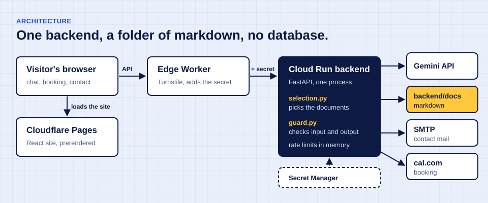

# Architecture

AI Portfolio Kit is a static frontend, a thin edge Worker, and one backend process that reads a
folder of markdown. There is no database.

  

## Components

| Component | Runs on | Why |
|---|---|---|
| Frontend (`frontend/`) | Cloudflare Pages | It is a static bundle, so it is served from a CDN rather than from a container. |
| API front door (`edge/`) | Cloudflare Worker | Puts the API behind Cloudflare and adds the shared secret the backend checks. |
| Backend (`backend/`) | Google Cloud Run | Needs Python, calls the Gemini API, sends mail over SMTP. |
| Markdown corpus (`backend/docs/`) | Inside the backend image | The only content the chat answers from. |
| Secrets | Google Secret Manager | Attached to the service at deploy time, not passed as plain environment variables. |
| CI authentication | Workload Identity Federation | Keyless: the workflows hold no service-account key. |

Each component has its own README with the detail: [frontend](../frontend/README.md),
[backend](../backend/README.md), [edge](../edge/README.md),
[workflows](../.github/workflows/README.md).

## Request path

1. The browser loads the site from Cloudflare Pages.
2. API calls go to the API hostname, which is the Worker. The browser does not call Cloud Run
   directly.
3. The Worker (`edge/src/index.js`) keeps the path and query, removes any `X-Edge-Auth` header
   the caller sent, sets its own from the `EDGE_SECRET` Worker secret, and forwards the request.
   If it is not configured it answers 500; if the backend is unreachable it answers 502.
4. The backend middleware (`require_edge_secret` in `backend/main.py`) compares the header with
   `ORIGIN_SHARED_SECRET` in constant time and answers 403 on a mismatch. `/`, `/health` and
   CORS preflights are not checked. When `ORIGIN_SHARED_SECRET` is unset, nothing is enforced.
5. The chat and contact endpoints apply a per-client and a global rate limit
   (`backend/rate_limit.py`) and answer 429 with a `Retry-After` header when a caller is over it.
   A request that proved it came through the Worker is keyed on the visitor address the Worker
   passes along; any other request is keyed on the last forwarded-for entry.
6. For a chat question, the backend selects documents from the corpus and calls the Gemini API.
   For a contact request, it sends one email over SMTP.

## Data boundaries

| Boundary | What crosses it |
|---|---|
| Browser -> Worker -> backend | The visitor's message, the conversation history the browser holds, and request headers. |
| Backend -> Gemini API | The question, a bounded number of recent turns, and the selected documents from `backend/docs/`. |
| Backend -> SMTP | The visitor's email address, their message and a timestamp, addressed to the owner's inbox. |
| Secret Manager -> backend | The Gemini API key, the mail password and the edge shared secret. |
| Repository -> public | Everything under `backend/docs/`. It is tracked in a public repository. |

[PRIVACY.md](PRIVACY.md) states what is logged and what is kept.

## Configuration overview

Names and locations only. Values are never written in the docs.

| Area | Where it lives | Settings | Detail |
|---|---|---|---|
| Frontend build values | `frontend/site.config.ts` (committed, public) | `url`, `backendUrl`, `avatarUrl` | [frontend README](../frontend/README.md#configuration) |
| Frontend local overrides | Environment variables read at build time | `VITE_SITE_URL`, `VITE_BACKEND_URL`, `VITE_AVATAR_URL`, `VITE_ALLOW_UNCONFIGURED_BUILD` | [frontend README](../frontend/README.md#configuration) |
| Backend required | Local env file (gitignored); Cloud Run environment and Secret Manager when deployed | `GEMINI_API_KEY`, `EMAIL_ADDRESS`, `EMAIL_PASSWORD`, `YOUR_EMAIL` | [backend README](../backend/README.md#configuration) |
| Backend CORS | Same as above | `ALLOWED_ORIGINS`, `FRONTEND_PROD_URL`, `FRONTEND_DEV_URL`, `FRONTEND_VITE_URL` | [backend README](../backend/README.md#configuration) |
| Backend edge secret | Secret Manager when deployed | `ORIGIN_SHARED_SECRET` | [backend README](../backend/README.md#the-edge-secret) |
| Backend rate limits | Environment variables, with defaults in `backend/rate_limit.py` | `RATE_LIMIT_CHAT_PER_IP_PER_DAY`, `RATE_LIMIT_CHAT_GLOBAL_PER_DAY`, `RATE_LIMIT_CHAT_WINDOW_SECONDS`, `RATE_LIMIT_CONTACT_PER_IP_PER_MINUTE`, `RATE_LIMIT_CONTACT_GLOBAL_PER_MINUTE` | [backend README](../backend/README.md#rate-limiting) |
| Edge Worker | `edge/wrangler.jsonc` (committed, public) | `name`, `routes`, `vars.ORIGIN_URL` | [edge README](../edge/README.md) |
| Edge Worker secret | Cloudflare only, set with `wrangler secret put` | `EDGE_SECRET` | [edge README](../edge/README.md) |
| CI secrets and variables | GitHub repository settings | Listed in the workflows README | [workflows README](../.github/workflows/README.md#required-configuration) |

Two rules hold across all of it:

- A value a visitor's browser can already see is not a secret and may be committed. Credentials
  stay in Secret Manager, in Cloudflare or in GitHub secrets.
- `GEMINI_API_KEY`, `EMAIL_PASSWORD` and `ORIGIN_SHARED_SECRET` reach the deployed backend from
  Secret Manager (`--set-secrets` in `.github/workflows/backend-deploy.yml`), and the container
  runs as a separate runtime service account, not as the account that deploys it.

## API

All routes are defined in `backend/main.py`.

| Endpoint | Purpose |
|---|---|
| `GET /` and `GET /health` | Health check. Reachable without the edge secret. |
| `GET /api/chat/status` | Whether the chat has a corpus to answer from, as one boolean. |
| `POST /chat-with-files` | The chat. Rate limited; request size is bounded by the schema. |
| `POST /api/contact` | Sends a contact email. Rate limited; address and length are validated first. |
| `GET /api/content/{file_name}` | Reads one document, confined to the profile folder. |
| `GET /api/projects` and `GET /api/projects/{slug}` | Project data. |
| `GET /api/writing` and `GET /api/writing/{slug}` | Published writing. |

Unexpected errors are logged on the server and returned to the caller as an opaque
"Internal server error".

## The context layer

What the chat may know, and how it may answer, is decided in a small set of files:

| File | Responsibility |
|---|---|
| `backend/docs/profile/` | The owner's own documents. Always part of what the model is given. |
| `backend/docs/projects/`, `backend/docs/writing/` | Published write-ups. They drive the site's pages and the chat from the same files. |
| `backend/docs/templates/` | Placeholders for a new owner. Never sent to the model. |
| `backend/context.py` | Builds the corpus, one labelled section per document, and caches it until a file's size or modification time changes. |
| `backend/selection.py` | Chooses which documents a question needs. |
| `backend/prompt.py` | Holds the instruction that tells the model to answer only from the corpus (described in the [backend README](../backend/README.md#the-context-layer); pinned by `backend/tests/test_context_layer.py`). |

How it behaves:

- **An empty corpus is an error, not a fallback.** With no profile documents the corpus is
  treated as empty, the status endpoint reports it, and the model is not called.
- **Selection is deterministic.** It is word overlap weighted by how rare a word is across the
  documents; there is no second model call. Profile documents are never dropped.
- **Selection fails open.** If nothing distinguishes one document from another, all of them are
  sent. A greeting with no topic gets the profile documents only.
- **The answer trace is a receipt, not a guess.** It reports the usage figures the API returned
  and how many documents of each kind were sent. It does not claim which document an answer
  came from, and it is absent when no model produced the reply.
- **The contact flow does not reach the model.** A message that is an email address, or that
  asks how to get in touch, is answered by the backend itself.

Changes to the prompt or the profile are checked against a question set that is run by hand, as
the [backend README](../backend/README.md#changing-the-prompt-or-the-profile) describes. The
tests in `backend/tests/` cover what can be asserted offline.

## CI

| Workflow | Runs when | Jobs |
|---|---|---|
| `frontend-deploy.yml` | Pull requests and pushes to `main` that change `frontend/` | `verify`, then `deploy-pages` |
| `backend-deploy.yml` | Pull requests and pushes to `main` that change `backend/` | `verify`, then `deploy` |
| `hygiene.yml` | Every pull request and every push to `main` | `hygiene` |

- **Verify jobs run on pull requests** and need no cloud credentials. Frontend: install,
  typecheck, lint, format check, link-preview copy check, build, dependency audit. Backend:
  install, compile, import smoke check, `pytest`, dependency audit.
- **Deploy jobs run only on a push to `main`**, after `verify` passes. They target fixed service
  names, so they never run for a pull request. The Pages deploy is additionally gated on the
  `CLOUDFLARE_PAGES_ENABLED` repository variable.
- **The edge Worker is not deployed by CI.** It is deployed by hand; see the
  [edge README](../edge/README.md).
- **Actions are pinned to commit SHAs.** The backend deploy authenticates to Google Cloud
  through Workload Identity Federation, with no stored service-account key.

The [workflows README](../.github/workflows/README.md) covers the deploy specifics and
troubleshooting.
